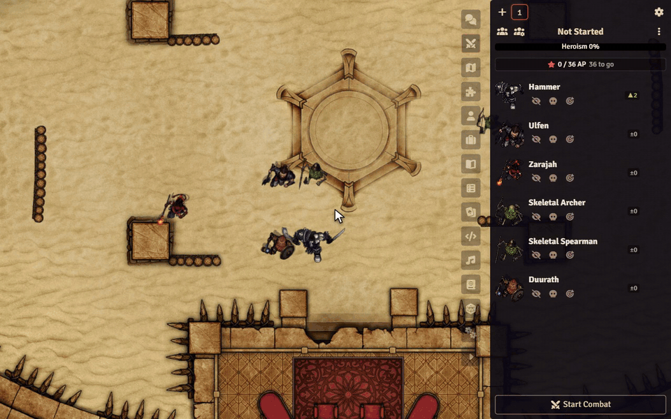

# Sephral’s Crucible Combat Pulse

**Crucible fights have a pulse nobody at the table can see. Combat Pulse puts it into the combat tracker.** How close is the next Heroism point? When does the Morale escalation hit? Who acts first next round? Your players can plan around it, and you no longer have to count.

*The demo uses three heroes, three adversaries and the arena map of Crucible's playtest adventure.*

## Highlights

* **Heroism in numbers:** below Crucible's Heroism meter the tracker shows exactly where the party stands, for example *14 / 24 AP, 10 to go*.
* **Heroism alert:** when the meter is full it flashes, and everyone learns that the heroes gained a point.
* **Escalation at a glance:** a countdown to round 7, then the current and the next amount. Badges show who gained or lost Morale, even after someone delays.
* **Initiative forecast:** Crucible rolls initiative every round. A badge next to each combatant shows the boons and banes of the next roll if the round ended now: unspent AP, slow weapons, bulky armor, Broken, ranks and talents. Hover for the dice and the average.
* **No spoilers:** the forecast reveals unspent AP, so the GM decides who sees it. By default everyone sees it for heroes and only the GM for adversaries.
* **Hands off your game:** the module never rolls dice and never changes an actor or a roll. It only shows what Crucible already knows.

## How it works

1. Enable the module in your Crucible world.
2. Start a fight. Heroism, escalation and the forecast appear in the combat tracker, in the sidebar and in the popout.
3. Click the gear next to the Heroism numbers to choose what you see. Every user decides for themselves.

## Install

Search for **Crucible Combat Pulse** in Foundry's module browser or open the [package page](https://foundryvtt.com/packages/sephrals-crucible-combat-pulse).

Foundry VTT 14 · Crucible 0.11 · English and German

Crucible is still in development. After an update of Crucible or Foundry the GM gets a short notice, and a self test in the module settings checks that everything still works.

## Learn more

Every setting, the self test and the macro API are in the [manual](MANUAL.md). Questions or ideas? Join us on [Discord](https://discord.gg/7BjCgDYaBP). Looking for more? See [all modules by Sephral](https://github.com/Sephral).

## License

See [LICENSE.md](LICENSE.md).
